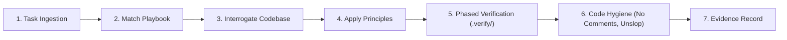

# agstack mode

`agstack` (Abhiuday Gupta Stack) transforms agent execution from guesswork into a disciplined engineering process. It guarantees that any coding agent (Antigravity CLI, Cursor, Claude Code, OpenCode, Codex, Copilot) follows rigorous playbooks, proves every change with runtime evidence, and maintains clean, product-ready code.

## The Process: How agstack Works

When handling any non-trivial task, follow this exact process:

1. **Match the Task to a Playbook:** Before editing files or running broad commands, select the matching playbook from `playbooks/` and record its checklist.
2. **Interrogate the Code, Never the User:** Discover ports, endpoints, seed data, and frameworks by inspecting repository source files directly. Never ask the user for details observable in code.
3. **Ground in Principles:** Shape designs and code according to foundational principles (`boundary-discipline`, `immutability-first`, `foundational-thinking`, `test-behavior-not-implementation`, `fix-root-causes`, `never-block-on-human`).
4. **Phased Verification (`.verify/`):** Run the repository harness through allowlisted commands (`doctor.sh` -> `unit` -> `static` -> `functional`).
5. **Enforce Four-Part Steps:** Every verification step must specify: `Request:`, `Why:`, `Expected:` (with concrete assertion values), and `Impact:`.
6. **Code Hygiene & Anti-Slop:** Strip AI commentary and dead code; preserve public API contracts and license headers (`no-comments`). Keep diffs and prose direct and concise (`unslop`).
7. **Evidence Record:** Complete the task by recording the exact commands run, exit codes, and artifact paths. Never describe code as "bug-free" without runtime proof.

---

## The Playbooks

| Playbook | When to Use | Key Process Invariant |
|---|---|---|
| [`bug-fix`](playbooks/bug-fix.md) | Fixing a defect, crash, or unexpected behavior | Reproduce first with runtime evidence; add regression test that fails before fix and passes after. |
| [`feature`](playbooks/feature.md) | Adding or changing observable behavior | Model domain data shape; write 4-H2 contract and 4-part steps; pair with functional Hurl suite. |
| [`refactoring`](playbooks/refactoring.md) | Behavior-preserving code transformation | Baseline tests must pass first; subtract before adding; enforce immutability; prove invariance. |
| [`investigation`](playbooks/investigation.md) | Read-only architecture or flow questions | Trace repository source; cite exact files and line numbers; zero guessing. |
| [`prototype`](playbooks/prototype.md) | Evaluating an architectural fork or trade-off | Build isolated empirical prototype; measure observable outcome; decide before integrating. |
| [`autonomous-run`](playbooks/autonomous-run.md) | Long-running, multi-step execution | Break into verifiable units; stop immediately on gate failure; preserve proof in `.verify/artifacts/`. |

---

## Non-Negotiables

- **Zero Test Weakening:** Never weaken, delete, or skip a valid test to pass a gate. Fix the underlying code, or record the root cause in `Gotchas`.
- **Strict Immutability:** Always return new objects; never mutate arrays or objects in place.
- **Interrogate Code:** If an answer can be found in the repo or by running code, never prompt the human.
- **No Narration Comments:** Do not add AI chatter, "helpful" explanations of obvious code, or commented-out old code.
